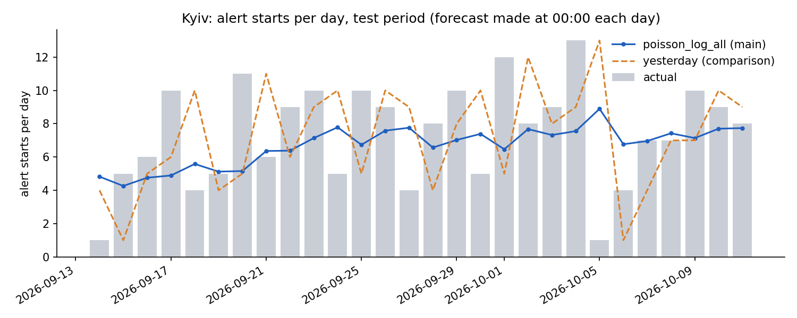

# Air-raid alerts in Kyiv: one-day-ahead forecast of alert starts

Stage 2 mini project, KSE Agentic AI School: time series analysis of air-raid alerts in Ukraine.

## Task

The program estimates how many air-raid alerts will **start** in **Kyiv city** (not Kyiv oblast)
during one calendar day (Kyiv local time). The estimate is made as if at **00:00** of that day,
using only days before it. For comparison it also shows a simple rule: "as many as yesterday".

I chose the daily number of alert starts because every forecast can be checked against the real
count at the end of the day. Start times of single alerts, threat type and duration were dropped:
they are either hard to check fairly or not known in advance in the available data.

The repository does not produce a live forecast for tomorrow. Its example is a **reproduced
forecast for 12 October 2026**, made with data up to and including 11 October.

## Data

- **Source:** Kyiv city open data portal, dataset "Статистика повітряних тривог у місті Києві"
  (Department of Municipal Security):
  https://data.kyivcity.gov.ua/dataset/statystyka-povitrianykh-tryvoh-u-misti-kyievi-dep-municipal
- **File:** `data/raw/airAlert_2026-10-12.json`, kept unchanged: 2641 alerts for Kyiv city,
  28 Feb 2022 - 12 Oct 2026. Only the start times are used for the forecast.
- **Time zone:** the file has no time zone. Compared with a UTC-based public dataset, the times match
  Kyiv local time (the comparison script is not part of this repository).
- **Preparation** (`src/prepare_data.py`): checks the file (fields, unique records, only Kyiv city,
  end after start, no duplicates or overlaps), then counts alert starts per calendar day;
  days without alerts get 0. **12 October is incomplete** (the file was downloaded that day) and is
  excluded from all calculations that need complete days.

## Method and checks

**Simple rules first.** A model is only useful if it beats simple rules, so I measured them first:
`yesterday` (as many as yesterday), `mean_7d` and `mean_28d` (average of the last 7 or 28 days).

**Model.** A Poisson regression, a standard model for counts. At 00:00 it gets three inputs:
yesterday's count, the 7-day average and the 28-day average, and combines them into the expected
number of alert starts. It is retrained every day on all earlier days. Eight variants were compared;
the chosen one, `poisson_log_all`, uses the logarithm of the inputs and the whole history.

**Training, validation, test.** The days are split in time order:

| Part | Dates | Purpose |
|---|---|---|
| Training | up to 16 Aug 2026 | history the model learns from |
| Validation | 17 Aug - 13 Sep 2026 | comparing methods and choosing one |
| Test | 14 Sep - 11 Oct 2026 | one final check of the chosen method |

On validation and test the forecast is made day by day: for 17 August only data up to 16 August
is used, and so on. The rule for choosing was fixed in advance: the smallest MAE on validation.
The test was run once after the choice; nothing was changed afterwards.

**Error measures.**
- **MAE** (mean absolute error): how many alerts the forecast was off by on average. Lower is better.
- **Bias**: the average of (forecast minus actual); negative means the forecast is too low on average.

**Protection against using the future.** Each forecast receives only days before the forecast day,
and the code stops if this is violated. While methods were compared, the code refused to use test days.
`tests/check_basics.py` holds 21 checks on small examples with answers computed by hand.

## Results

| Method | Validation MAE | Validation bias | Test MAE | Test bias |
|---|---|---|---|---|
| `poisson_log_all` (chosen) | 3.20 | -1.82 | **2.53** | -0.68 |
| `yesterday` | 3.25 | +0.04 | 3.57 | -0.14 |

- On validation the model and `yesterday` were practically equal (difference 0.05; model better on 16 of 28 days).
- On the test period the model was better on 18 of 28 days.
- Other variants and rules on validation: `results/validation_models.csv`.



**Reproduced forecast for 12 October 2026** (as if at 00:00, data up to 11 October):
`poisson_log_all` **7.4** expected alert starts, `yesterday` 8. The real total for 12 October is
unknown: the file contains that day only up to the moment of download. The test MAE (2.53) is an
average over past days, not a guaranteed range for this forecast.

## Main limitations

1. **The test was not fully blind.** During data exploration, before the split, daily counts up to
   11 October were shown and the test-period average was mentioned once. The method was chosen on
   validation, but the level of the test period was known.
2. **Little data for the choice and one test period.** Validation is 28 days with a sharp jump in
   alerts; 8 variants were compared on the same days, and validation was used twice (the `log`
   variants were added after the first results). Whether the test result holds for other periods
   was not checked.
3. **Publication time of records was not checked.** All forecasts use one file downloaded on
   12 October 2026 (exact time not recorded), after the moment of each forecast. Each forecast uses
   only alerts that started before its 00:00, but when each record appeared in the source, and
   whether records were added or corrected later, was not checked.
4. **Warnings on macOS.** On macOS the numerical library prints warnings during training
   ("divide by zero", "overflow", "invalid value" in matrix multiplication); on Linux it does not.
   `tests/diagnose_warnings.py` showed that on validation all fits finished normally and all forecasts
   match a by-hand calculation and reference results from a machine without warnings; `final_test.py`
   repeats these checks for every test day with no problems found. The cause was not established.
5. **Other:** the model forecasts too low on average; no probabilities or ranges were built or checked;
   a day with 0 alerts cannot be told apart from missing data; other methods, other regions and news
   data were not tried.

## How to run

Checked with Python 3.9.6 on macOS; library versions are fixed in `requirements.txt`.

```bash
python -m venv venv
source venv/bin/activate
pip install -r requirements.txt

python src/prepare_data.py         # check the raw file, build daily counts
python tests/check_basics.py       # 21 checks on small examples
python src/baselines.py            # simple rules on validation
python src/model.py                # model variants on validation (about 1 minute)
python src/final_test.py --again   # final test (already run once; --again repeats it)
python src/forecast.py             # reproduced forecast for 12 October
python tests/diagnose_warnings.py  # optional: training check on validation
```

The full AI conversation, including the decisions and corrections made during the work, is submitted separately.